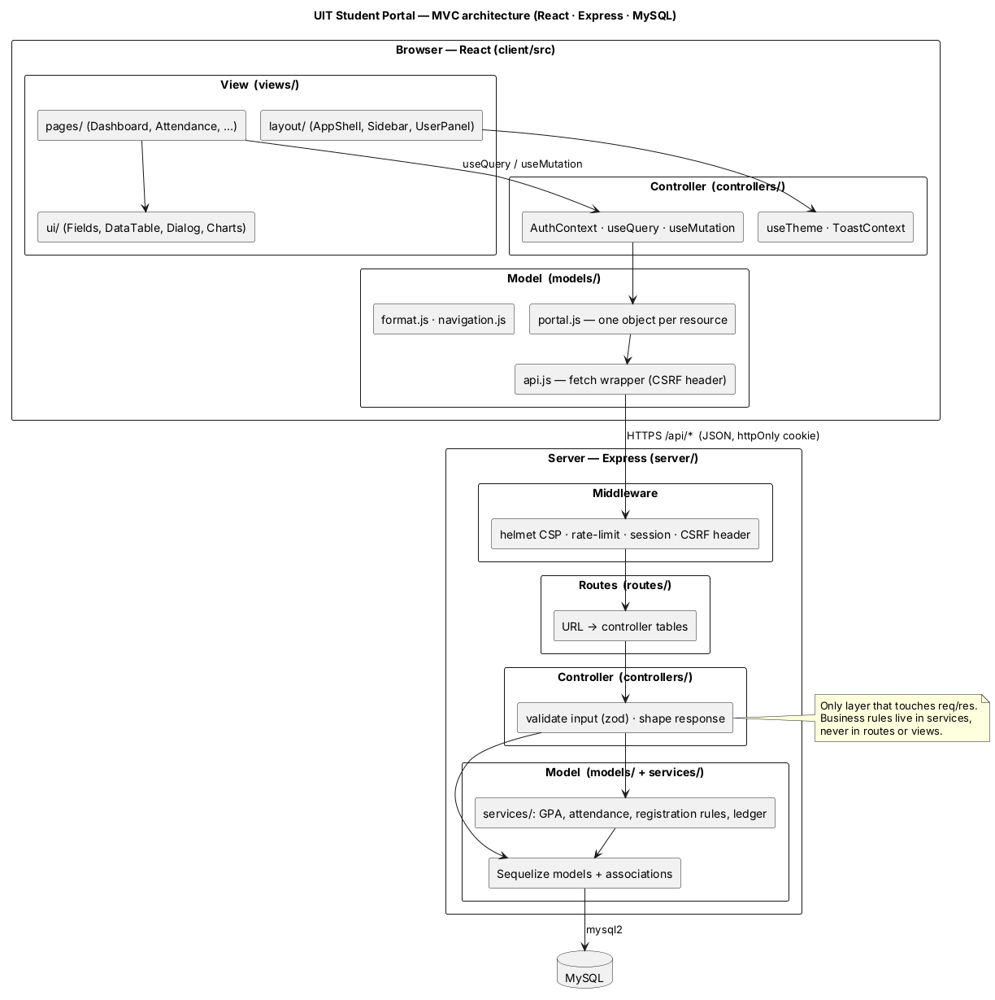
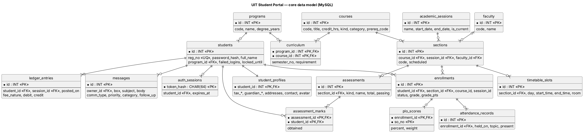
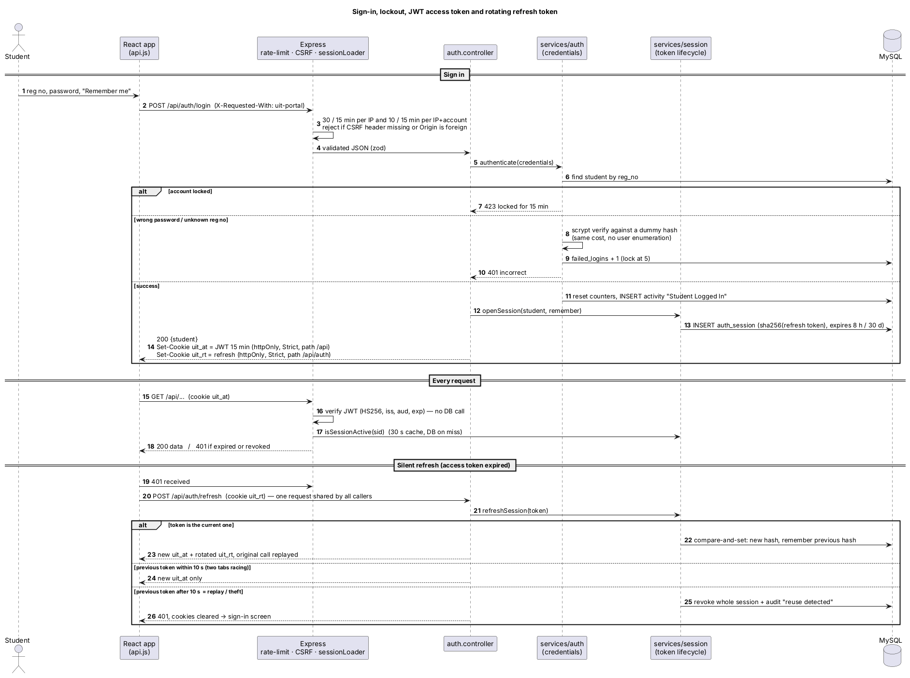
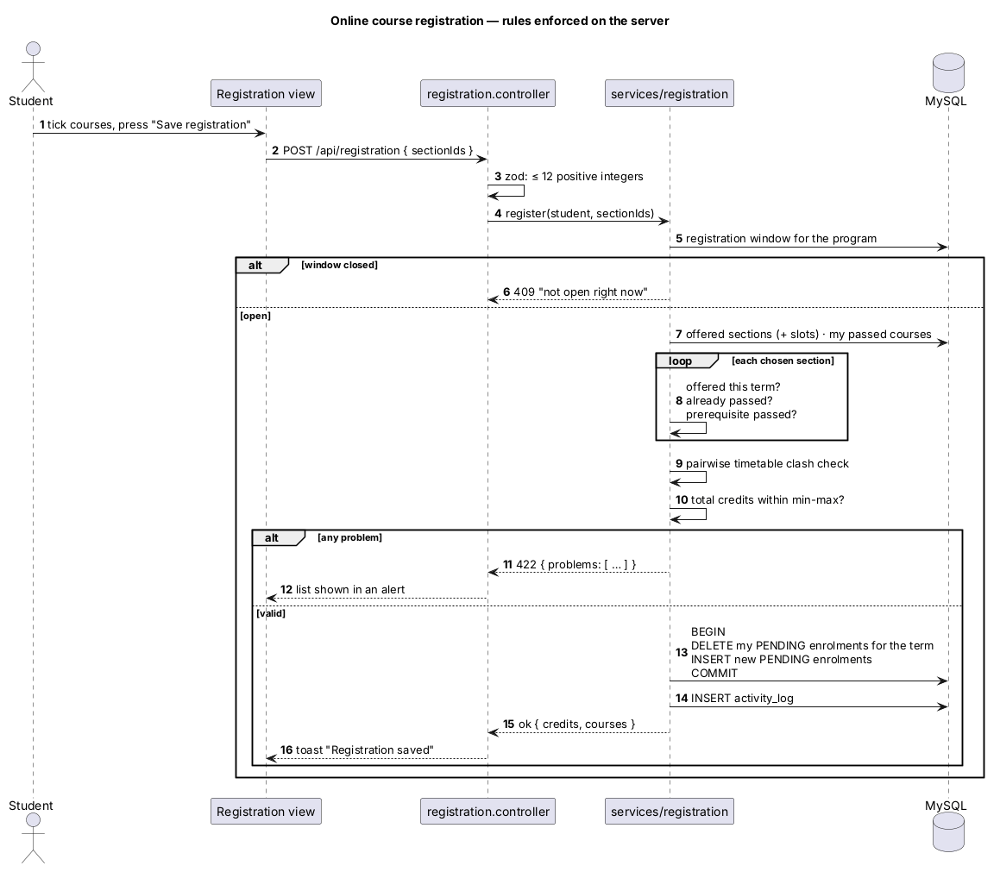
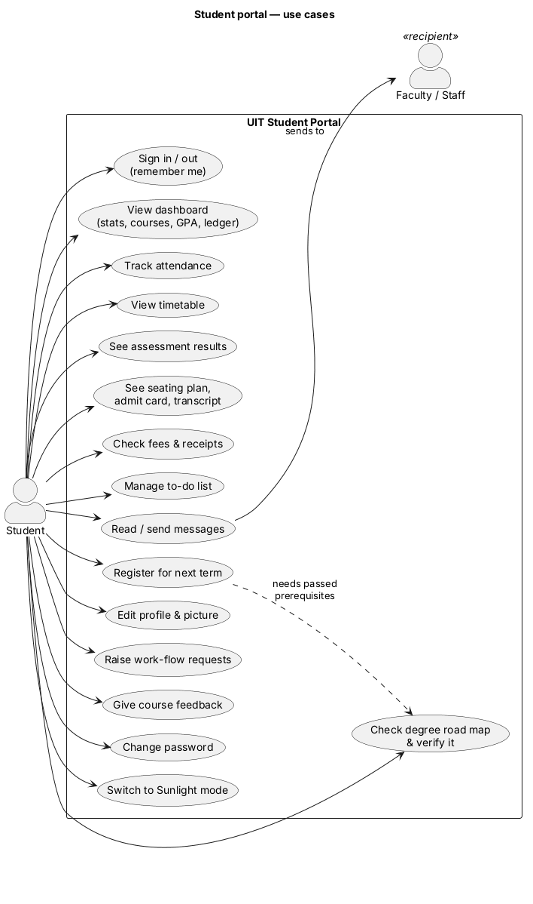

# UIT Student Portal — MySQL · Express · React · Node.js (MVC)

A rebuild of the UIT University student portal (`eduboard.uit.edu/StudentPortal`) with a real backend.

* **Classic theme (default)** — a faithful copy of the original look, using values *measured from the live portal*
  (Poppins 13 px, `#EEF0F8` background, `#3699FF` primary, 265 px sidebar, 65 px header, 54 px sub-header, card radius 5.46 px …).
* **Sunlight theme (toggle, ☼ in the header)** — the "enhance" step of the assignment: dark ink on white, AAA text contrast,
  larger type, heavier borders, 44 px touch targets, and a thumb-reach bottom bar on phones. Also switches on automatically
  with the OS `prefers-contrast: more` setting inside this theme.

> Classic deliberately keeps the original's pale-grey text (`#B5B5C3` ≈ 2:1 contrast). That is a property of the original design,
> not a bug. When you finish refactoring, make Sunlight the default by changing one line: `readTheme()` in
> `client/src/controllers/useTheme.js` (and `data-theme` in `client/index.html`).

---

## 0. One-click launcher (easiest way to test)

| OS | Do this |
|---|---|
| **Windows** | double-click **`Start UIT Portal.bat`** |
| **macOS** | double-click **`Start UIT Portal.command`** (first time: right-click → Open) |
| **Linux / WSL** | `./start-uit-portal.sh` |

On first run it asks (once) whether to put a shortcut on your Desktop. Every run it: checks Node ≥ 20 (offers to install it on Windows/macOS) →
installs dependencies only if missing or the lockfile changed → checks for dependency updates at most once a day (`npm update`, stays within the
versions in `package.json`; reports newer major versions without applying them) → rebuilds the React client only if sources changed → looks for MySQL →
starts the server on the first free port from 3000 and opens your browser.

* **No MySQL yet?** It offers **Preview mode**: the same UI served by a stand-in API with sample data (nothing is saved). Good for judging the look.
* **With MySQL**, it asks for host / user / password once, writes them to `.env` (git-ignored) and the server creates the database and seeds demo data on first start.
* Flags: `--preview` · `--no-open` · `--update` / `--no-update` · `--yes` (no prompts) · `--reconfigure` · `--install-shortcut`. Same thing via `npm run launch`.

## 1. Quick start

```bash
# 0) a MySQL 8 (or MariaDB 10.6+) server you can create a database on
cp .env.example .env            # then export those variables, or set them in your shell

npm install                      # server dependencies
npm run build                    # installs + builds the React client into client/dist
npm run seed                     # creates the schema and loads FICTIONAL demo data (drops existing tables!)
npm start                        # http://localhost:3000
```

Demo sign-in: **`23FA-001-SE` / `Portal@2026`** (second student: `23FA-002-SE`, same password).

Development with hot reload: `npm run dev` (API on :3000) and `npm run dev:client` (Vite on :5173, proxies `/api`).

Configuration is read once, validated with zod, and the server refuses to start on bad values (see [`.env.example`](.env.example)).
**Production requires `JWT_SECRET`** (≥ 32 chars, `openssl rand -base64 48`); demo data is *not* loaded in production unless `SEED_DEMO=true`.

### Docker
```bash
printf 'MYSQL_PASSWORD=%s\nJWT_SECRET=%s\n' "$(openssl rand -hex 16)" "$(openssl rand -base64 48)" > .env
docker compose up --build        # MySQL 8.4 + the app (non-root, read-only filesystem) on http://localhost:3000
```
Probes: `GET /healthz` (liveness), `GET /readyz` (database ping) — the image's `HEALTHCHECK` uses `/readyz`.

---

## 2. Architecture (MVC on both sides)



| | **Model** | **View** | **Controller** |
|---|---|---|---|
| **Server** `server/` | `models/` (Sequelize) + `services/` (GPA, attendance, registration rules, ledger) | JSON responses (shape owned by controllers) | `controllers/` — the *only* layer that touches `req`/`res`; `routes/` only map URL → controller; `validators/` (zod) guard input |
| **Client** `client/src/` | `models/` — `api.js`, one object per resource in `portal.js`, formatters, navigation map | `views/` — `pages/`, `ui/`, `layout/`, `charts/` | `controllers/` — hooks (`useQuery`, `useMutation`, `AuthContext`, `useTheme`, `ToastContext`) |

Rules that keep it clean: views never call `fetch`; routes contain no logic; business rules live in services (unit-tested without a database).

SOLID in practice: **S** — `services/auth.js` (credentials) vs `services/session.js` (token lifecycle) vs `services/activity.js` (audit trail), `lib/` for infrastructure (crypto, jwt, cache, logger);
**O** — new endpoints are new controller + route files, nothing central changes; **D** — controllers depend on service functions, not on Express or Sequelize details; pure decision functions
(`evaluateRefresh`, `validateSelection`, `gpaHistory`) are separated from I/O so they are tested without a database.

### Performance & caching

| Layer | What |
|---|---|
| Server cache | `lib/cache.js` — TTL + LRU + **request coalescing** (25 simultaneous dashboard loads = 1 query set) + deep-frozen values. Reference data 1–5 min, per-student read models 20–30 s |
| Invalidation | one middleware (`middleware/cache.js`): any successful write by a student drops everything cached under `s:<id>:`; message delivery also drops the recipients' |
| Stateless auth | access JWTs verify with no DB hit; session-liveness answered from a 30 s cache |
| Client | stale-while-revalidate `useQuery` cache (instant back-navigation), aborted requests, route-level code splitting (~65 KB gz first load), self-hosted fonts, service-worker app shell |
| HTTP | hashed assets `immutable` for a year, gzip, `no-store` on API responses (student data never sits in a shared computer's disk cache) |
| Database | indexed foreign keys / lookup columns, `separate` queries instead of join blow-ups, pool size via `MYSQL_POOL_MAX`, hourly sweep of expired sessions |

```
server/
  index.js · app.js · config.js · db.js
  models/        academic · student · services · index (associations)
  services/      academics · fees · auth · session · activity · registration · messaging · dashboard
  lib/           crypto (scrypt, tokens) · jwt · cache (TTL/LRU/coalescing) · logger · ids
  controllers/   auth · dashboard · course · attendance · timetable · assessment · record · exam · fee · todo · message · workflow · community · registration · profile
  routes/        *.routes.js + index.js
  validators/    zod schemas
  middleware/    auth (JWT session loader, cookies, CSRF/Origin guard) · cache (invalidate-on-write) · errors
  seed/          data.js (fictional) + index.js
client/src/
  models/ controllers/ views/{pages,ui,layout,charts}/ styles/{fonts,tokens,base,layout,components,pages}.css
tools/  audit (contrast, UI/a11y audit, mock API) · scrape (how the original was studied)
docs/diagrams/  PlantUML sources + PNG/SVG
test/           node:test suites
```

### Data model



The exact DDL is in [`docs/schema.sql`](docs/schema.sql) (30 tables, 35 foreign keys), generated offline from the models with `npm run schema` — no database needed.
Calendar dates are stored as `DATEONLY` (`YYYY-MM-DD`) so they never shift with time zones. Money is `DECIMAL(12,2)`.
MySQL has no TTL indexes, so expired sign-in sessions are swept at boot and hourly. `auth_sessions` holds one row per sign-in (hashed refresh token, previous hash for theft detection, revoked/expiry stamps).

### Key flows

| Sign-in, lockout, sessions | Registration rules |
|---|---|
|  |  |



---

## 3. Pages (all of the original's navigation, plus the quick-user panel)

| Menu | Page | Notes |
|---|---|---|
| Dashboard | `/` | My Stats, Courses (+ course link), Overview, Activity, GPA chart, Marked Attendance, Announcements (+ pop-up once per session), Todo, Surveys, Degree Completion, Financial Ledger |
| Course | `/courses`, `/courses/:id` | course cards, schedule, attendance, marks so far |
| Exam | Assessment Result · Exam Seating Plan · Online Exam · Unofficial Transcript · Print (Lab) Admit Card | admit card withheld while dues exist |
| Fee | My General Ledger · Student Advance Fee | running balance, totals, pager, receipts |
| General | Time Table · Todo List · Attendance · New Communication · Road Map · Work Flow · Change Password · PLO Attainment | road map has filters, legend, GPA summary and **verify** form; communication has the original's type/priority/category/date/follow-up/reminder fields and recipient grid |
| Registration | Register Online (For Regular) | prerequisites, credit window, timetable-clash check — all enforced server-side |
| User panel | My Profile (+ picture upload) · My Messages · My Activities · My Tasks · Change Password · Sunlight mode · Sign out | |

---

## 4. API (all under `/api`, JSON, cookie session)

| Area | Endpoints |
|---|---|
| Auth | `POST /auth/login` · `POST /auth/refresh` (rotates the refresh cookie) · `POST /auth/logout` · `GET /auth/me` (200 `{student:null}` when anonymous; renews an expired access token from the refresh cookie) · `POST /auth/change-password` |
| Ops (outside `/api`) | `GET /healthz` · `GET /readyz` |
| Dashboard | `GET /dashboard` (one round-trip for the whole page) |
| Academics | `GET /courses` · `/courses/:id` · `/attendance` · `/attendance/:id` · `/timetable` · `/assessments/filters` · `/assessments` · `/roadmap` · `PUT /roadmap/verification` · `/transcript/programs` · `/transcript` · `/plo` |
| Exams | `GET /exams/seating` · `/exams/online` · `/exams/admit-card?kind=FINAL\|MID\|LAB` |
| Fees | `GET /fees/ledger` · `/fees/advance` · `/fees/advance/:id` |
| To-do | `GET/POST /todos` · `PUT/DELETE /todos/:id` |
| Messages | `GET /messages` · `/messages/recipients` · `/messages/:id` · `POST /messages` · `DELETE /messages/:id` |
| Work flow | `GET/POST /workflows` · `PUT/DELETE /workflows/:id` · `POST /workflows/:id/submit` |
| Community | `GET /announcements` · `/surveys` · `POST /surveys/:id/respond` · `GET /activity` |
| Registration | `GET/POST /registration` |
| Profile | `GET/PUT /profile` · `GET/PUT/DELETE /profile/avatar` |

Errors are `{ error, details? }` with honest status codes (401, 403, 404, 409, 422 with per-field `details`, 423 locked, 429 rate-limited).

---

## 5. Security

Full table in [`SECURITY.md`](SECURITY.md). Highlights:

* **Sessions = short JWT + rotating refresh token.** A 15-minute HS256 *access JWT* (httpOnly, `SameSite=Strict`, path `/api`, verified without a database call)
  and an opaque *refresh token* (httpOnly, path `/api/auth`, only its SHA-256 stored). Every refresh rotates the token; replaying a rotated one after a 10 s grace window
  (two tabs racing) revokes the whole session. The browser renews silently on a 401 (single-flight) — tokens are never readable by JavaScript.
  "Remember me" = 30 days, otherwise 8 hours. Sign-out and password change revoke server-side (honoured within 30 s even though JWTs are stateless).
* JWT hygiene: algorithm pinned, issuer + audience + expiry enforced, secret mandatory (≥ 32 chars) in production.
* Passwords: **scrypt** (N=2¹⁵, r=8, p=3, per-hash salt, parameters stored in the hash and upgraded on next sign-in), NFKC-normalised, constant-time compare; login does equal work for unknown users (no enumeration).
* Brute force: 30 sign-ins / 15 min / IP **and** 10 / 15 min per IP+account; 5 failures → 15-minute lock; 300 requests / min / IP on the API.
* CSRF: `SameSite=Strict` **plus** required `X-Requested-With: uit-portal` header **plus** `Origin` must equal the host on every write.
* Strict CSP (`default-src 'self'`, no inline scripts/styles), `helmet` (HSTS …), `Permissions-Policy`, `frame-ancestors 'none'`, JSON body limit 32 KB.
* Operations: structured JSON logs (pino) with cookies/passwords redacted and a request id on every response, graceful shutdown, DB connection retry.
* Every query is scoped to the signed-in student; other students' records return 404, never 403 (no existence leak). IDs are validated as positive integers; all SQL goes through Sequelize bindings.
* Profile picture: bytes are checked against JPEG/PNG signatures (not the `Content-Type`), ≤ 120 KB, served with `nosniff`; SVG is never accepted.
* Institution-controlled fields (name, DOB, NIC, gender, official e-mail) are never read from a request.

---

## 6. UX, accessibility and responsive design

Targets: WCAG 2.2 AA (AAA for Sunlight text), Nielsen's 10 usability heuristics, mobile-first.

| Heuristic | Where |
|---|---|
| Visibility of system status | skeleton → content → error-with-retry on every page; toasts; busy buttons; attendance level shown as text + colour + meter |
| Match with the real world | the university's own terms (Registration No, Road Map, Work Flow, PLO) and 24-hour class times |
| User control & freedom | Esc closes every dialog/drawer; cancel on every form; confirm before delete / final submit; collapsible sidebar |
| Consistency | one token set and one component library for every page |
| Error prevention | server-side registration rules; disabled actions explain why; date-range validation |
| Recognition over recall | recipient grids, course selects, filters, visible breadcrumbs |
| Flexibility | keyboard shortcuts via native controls, skip link, theme switch, print views |
| Help users recover from errors | per-field messages wired with `aria-describedby`, error summary focus, friendly 4xx text |

Responsive: tables become labelled record cards under 720 px; the timetable becomes a day agenda; the sidebar becomes a focus-managed drawer;
inputs are ≥ 16 px in Sunlight (no iOS zoom). Charts are hand-drawn SVG (≈ 3 KB) with a hidden data table for screen readers.
First-load JS is **~62 KB gzipped**; every page is its own 0.2–2 KB chunk; fonts are self-hosted; a service worker caches the app shell (never `/api`).

> **"HTS"** in the assignment brief — I treated it as "usability heuristics / web standards". If your sir meant something specific, tell me and I'll map it here.

---

## 7. Verification — what is and is not proven

| Check | Result |
|---|---|
| `npm test` — logic, validators, error mapping, CSRF/Origin guard, seed-data integrity, avatar signatures, scrypt, JWT forgery cases, refresh-rotation table, TTL cache, config validation, client silent-refresh | **52 / 52 pass** (no database needed) |
| `npm run lint` (ESLint 9 + react-hooks) | clean |
| `npm run test:integration` — 16 end-to-end API scenarios (login/cookies, every read endpoint, CRUD + isolation, cache invalidation, refresh rotation + theft, logout revocation, forged tokens, password change, lockout, rate limit) | **run by GitHub Actions on real MySQL 8.4** on every push (skipped locally unless `RUN_DB_TESTS=1`) |
| `npm run audit:contrast` — every text/background pair of the Sunlight theme | all pairs pass (AAA for text) |
| `npm run audit:ui` — 27 routes (incl. the 404 page) × desktop + phone, axe-core (WCAG 2.2 A/AA + best practice), overflow, `<h1>` count, console errors | **54 / 54 clean in both themes** (Classic's inherited palette contrast is reported separately) |
| Numeric comparison of the clone vs. the live portal (fonts, sizes, colours, radii, paddings) | shell and dashboard match; remaining differences are measurement-mapping noise |
| **Backend against a real MySQL server** | The authoring sandbox had no MySQL; the UI audit used `tools/audit/mock-server.mjs`, a stand-in that mirrors the controllers' response shapes. **The `integration` job in CI runs the API against real MySQL 8.4 — 16/16 scenarios pass**, including seeding, every read endpoint, refresh-token theft detection and lockout. What no automated check covers is a human clicking through every page against MySQL: run `npm run launch` and do that once. |

`npm audit` reports 2 *moderate* findings through Sequelize 6's `uuid@8` dependency (a buffer-bounds issue that only applies when a caller passes an output buffer, which Sequelize does not). CI fails on *high* or above.

Run the UI audit yourself: `npm run audit:mock` in one terminal, then `THEME=classic npm run audit:ui -- http://localhost:4173 ./audit-out` (needs Playwright).

---

## 8. Deliberate differences from the original

1. **Fictional data.** The original shows a real student's CNIC, guardian and grades; this repo contains none of that. `recon/` (git-ignored) holds the raw capture — delete it and change that portal password.
2. **Change Password asks for the current password** (the original does not) — a security fix.
3. **Course page** works; for the studied account the original said "Access restricted".
4. **Top-right of the dashboard** shows a "needs attention" card (next class, pending feedback, unread mail) where the original leaves a gap.
5. **Online Exam** lists exams but has no *FORM* button — there is no exam engine in scope.
6. **Forgot password** explains how to get a reset from the university; it does not e-mail anything.
7. **Attendance "Offset"** repeats the percentage, exactly as the original does.
8. **Logo and login photos** come from the live portal for coursework fidelity; the font is Poppins (SIL OFL), self-hosted.
9. Extras only in Sunlight: summary tiles, risk alert, status badges, password-rules checklist.

---

## 9. How the original was studied (`tools/scrape`)

`login_probe.js` → `crawl.js` (GET-only: never submits forms, never changes a password) → `structure.py` (tables, fields, labels).
Credentials are passed through environment variables, never stored in files. Run only with **your own** account.
